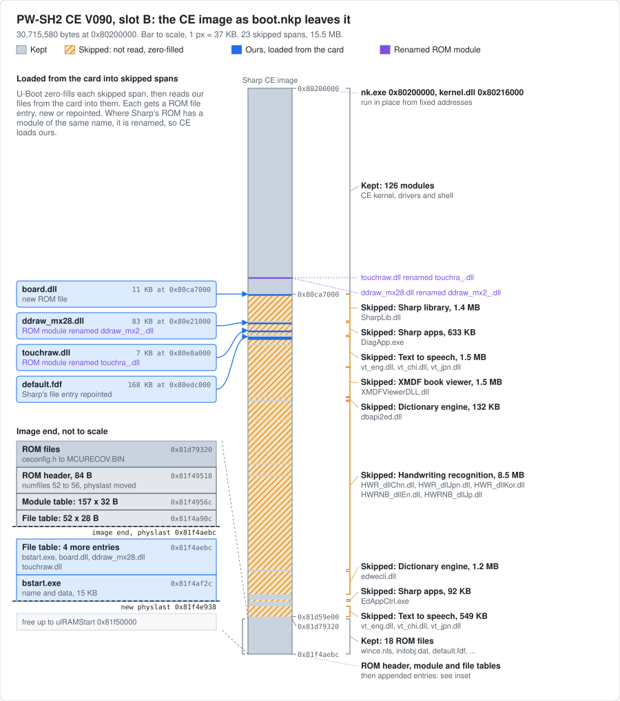

# Reference

## Card Files

All on the first (FAT32) partition.

| File | Purpose |
| --- | --- |
| `EDSA2CFG.BIN`, `EDSA1CFG.BIN`, `EDNA3CFG.BIN` | EBOOT boot config: run the U-Boot file from the card |
| `EDSA2EXE.BIN`, `EDSA1EXE.BIN`, `EDSH4EXE.BIN`, `EDNA3EXE.BIN` | U-Boot, one build per platform ([EBOOT Files](#eboot-files)) |
| `pwsh2-boot/nkgen.bin`, `nkgen.pak` | The patch generator and its inputs: drivers, profiles, registry additions and patches for every model ([boot.nkp](#bootnkp)) |
| `pwsh2-boot/nk-CRC/` | Patches for one CE image, CRC being its identity: `boot.nkp`, the drivers it loads in `modules/`, and for a generated bundle `cache.txt` and `nkgen.log` ([Generated Bundles](#generated-bundles)) |
| `pwsh2-boot/nk-LENGTH/boot.nkp` | Patches for one CE image of LENGTH bytes (8 hex digits), made by earlier patch makers and the command line, with the drivers it loads in `modules/` |
| `pwsh2-boot/boot.nkp` | Patches for this Brain's CE image, made by `tools/make-boot-nkp.mjs` |
| `pwsh2-boot/no-nkgen` | Marker: do not run the generator |
| `pwsh2-boot/boot-status.txt` | How the last boot from this card was patched ([Boot Status](#boot-status)) |
| `pwsh2-boot/PROFILE/menu.txt` | The boot menu's settings on this model ([menu.txt](#menutxt)) |
| `pwsh2-boot/menu.txt` | The boot menu's settings on a model without its own `menu.txt` |
| `pwsh2-boot/PROFILE/launch.txt` | What bstart starts on this profile's Brains ([launch.txt](#launchtxt)) |
| `pwsh2-boot/launch.txt` | What bstart starts on a Brain without its own launch file or profile |
| `pwsh2-boot/PROFILE/` | Files only this profile uses, such as its `explorer.exe` |
| `pwsh2-boot/PROFILE/Windows/` | Copied into `\Windows` at boot after `pwsh2-boot/Windows/`, on this profile's Brains only |
| `pwsh2-boot/dump-nk` | Marker: copy the CE image to the card at the next Windows CE boot, for the patch maker and command line |
| `pwsh2-boot/nk-slot-A.bin`, `nk-slot-B.bin` | The copied CE image |
| `pwsh2-boot/log` | Marker: write `pwsh2-boot/uboot.log` at each Windows CE boot, and log tablet mode changes to `pwsh2-boot/autorotate.log` |
| `pwsh2-boot/autorotate.exe` | Applies the saved rotation at boot and follows tablet mode |
| `pwsh2-boot/Keymap.exe` | [Keymap](../ce/keymap/README.md): key remaps and the keyboard map, started from each profile's `Windows/StartUp/Keymap.lnk` |
| `pwsh2-boot/PROFILE/keys.txt` | Optional key remaps for Keymap, in place of the profile's own ([keys.txt](../ce/keymap/README.md#keystxt)) |
| `pwsh2-boot/Windows/brain-control.cpl` | [Brain Control](brain-control.md), the settings applet, copied into `\Windows` at boot |
| `pwsh2-boot/PROFILE/display.txt` | Rotation and brightness settings, written by Brain Control |
| `pwsh2-boot/PROFILE/sound.txt` | Key click and screen tap settings |
| `pwsh2-boot/PROFILE/power.txt` | Idle timeouts, applied by bstart at boot on every model, and the battery type, applied on the PW-A7300 and PW-G5300 |
| `pwsh2-boot/debug/debugmgr.exe`, `usbserial.dll` | [Debug Agent](#debugtxt) and ce-debug's USB serial driver |
| `pwsh2-boot/PROFILE/debug.txt` | Whether bstart starts Debug Agent, written by Brain Control |
| `uEnv.txt`, kernel, device tree | Brainux, for the Linux entry ([menu.txt](#menutxt)) |

`PROFILE` is the Brain's profile id from `HKLM\Software\Brain` `Profile`, which every recognised bundle sets: `pwsh2`, `pwsb1`, `pwsh4` or `pwa7300` (also the PW-G5300). Without `Profile`, bstart uses `Model` lowercased with the punctuation removed. Without either (an unrecognised image), bstart uses only the shared files. The `display.txt`, `sound.txt`, `power.txt` and `debug.txt` settings are read from `pwsh2-boot/` when the profile folder has none, as earlier releases wrote them; Brain Control saves them to the profile folder.

Shared by every model: `pwsh2-boot/Windows/`, `pwsh2-boot/Programs/`, `pwsh2-boot/debug/`, `autorotate.exe`, `crashlog.exe`, `nkgen.bin`, `nkgen.pak`, `boot-status.txt`, the markers, and these logs:

| Log | Written by | On a shared card |
| --- | --- | --- |
| `pwsh2-boot/uboot.log` | U-Boot, with the `log` marker | The last boot of any model |
| `pwsh2-boot/nk-CRC/nkgen.log` | U-Boot, at each generation for that image | One per image |
| `pwsh2-boot/ce-debug.log`, `ce-debug-prev.log` | U-Boot, from the CE debug log a warm restart leaves in RAM | The last restart of any model |
| `pwsh2-boot/crash.log` | `crashlog.exe` | Appended by every model |
| `pwsh2-boot/autorotate.log` | `autorotate.exe`, with the `log` marker | Appended by every model |
| `pwsh2-boot/debug/debugmgr.log`, `usb-events.log` | Debug Agent | Appended by every model |

`nk-slot-A.bin` and `nk-slot-B.bin` are named by slot only, so a second Brain's image copy overwrites the first's if both use the same slot.

### EBOOT Files

EBOOT looks for these files under its Sharp platform name:

| Platform | Models | Files | U-Boot build |
| --- | --- | --- | --- |
| ED-SA2 | PW-SH2 | `EDSA2CFG.BIN`, `EDSA2EXE.BIN` | `pwsh2_ce_defconfig` |
| ED-SA1 | PW-SB1, PW-SH1, PW-HC4, PW-SJ1 | `EDSA1CFG.BIN`, `EDSA1EXE.BIN`, the same contents as the ED-SA2 files (tested on a PW-SB1) | `pwsh2_ce_defconfig` |
| ED-SH4 | PW-SH4 | `EDSH4EXE.BIN`. No config file: EBOOT runs it without one, and its config format differs ([PW-SH4](pwsh4.md)) | `pwsh4_ce_defconfig` |
| ED-NA3 | PW-A7300, PW-G5300 | `EDNA3CFG.BIN` (flags `0x02` only, the file tested on the PW-A7300), `EDNA3EXE.BIN` | `pwa7300_ce_defconfig` |

`EDSA3EXE.BIN`, `EDSA5EXE.BIN`, `EDSA6EXE.BIN` and `EDSA7EXE.BIN` are the PW-SH3, PW-SH5, PW-SH6 and PW-SH7 names. u-boot-brain has no CE configuration for them, so the release has no file for them.

## Boot Sequence

1. **EBOOT** (Sharp, internal) sets up clocks and the panel, shows the Brain splash and reads `EDSA2CFG.BIN`. Config flag `0x02` makes it run `EDSA2EXE.BIN` from the card at physical address `0x40200000`. Without the file, it boots internal CE as normal.
2. **U-Boot** leaves EBOOT's clocks and display set-up alone. It draws the menu over the splash, still in RAM where EBOOT loaded it, and sends frames to the panel with EBOOT's own command sequence and panel settings. It reads the keyboard over I2C, or on the PW-SH4 by scanning the key matrix.
3. **Windows CE:** `bootsharpce` finds the image EBOOT would boot (internal MMC, MBR partition 3, slot A or B by trailer) and reads it into RAM at `0x40200000`, skipping the spans listed in `boot.nkp`. It applies the patches, sets the boot arguments EBOOT would set, restores EBOOT's clock settings and jumps to the image.
4. **CE** runs `bstart.exe` from `HKLM\init\Launch50`, where Sharp's `explorer.exe` was. bstart enables suspend and idle in Sharp's power manager (`PWR1:`), signals the backlight events, shows a blue screen, waits for the card, sets the idle timeouts from `power.txt` and starts the program in `launch.txt`.
5. **Linux** boots the target set in [menu.txt](#menutxt): by default u-boot-brain's own boot command, which reads `uEnv.txt` from the card. Linux initialises the display itself.

`EDSA2CFG.BIN` and `EDSA1CFG.BIN` in releases use flags `0x22` and develop word `0xFFFFFFFF`. Flag `0x20` copies the develop word into RAM for CE; all its bits set means no develop options. `tools/make-edsa2cfg.mjs` refuses words that would clear bits Sharp's ROM depends on. `EDNA3CFG.BIN` is `make-edsa2cfg.mjs EDNA3CFG.BIN 0 0x02`: flag `0x02` alone and no develop word, byte for byte the config tested on the PW-A7300.

## launch.txt

bstart reads `pwsh2-boot/PROFILE/launch.txt`, or `pwsh2-boot/launch.txt` if the Brain has no profile or its profile folder has no `launch.txt`. Cards set up for one Brain with `pwsh2-boot/launch.txt` keep working.

UTF-8 or ASCII, one `key=value` per line:

| Key | Meaning |
| --- | --- |
| `program` | Full path of the program to start |
| `arguments` | Its command line (optional) |
| `wait-for-window` | Window class to wait for before removing the blue screen, up to 20 s (optional). Empty: wait until the program has a foreground window. |
| `restart-keyboard` | `yes` (default) or `no`: restart Sharp's soft keyboard driver (`SIP0:`) before starting the program |
| `restart-shortcut` | `yes` (default) or `no`: create `\Windows\Programs\Restart.lnk`, which runs `\Windows\bstart.exe restart` |
| `wallpaper` | Empty (default): plain blue desktop. `stock`: leave CE's wallpaper. A full path: use that image. Set in the RAM registry at each boot |
| `startup` | Full path of a program to run before `program`, before `pwsh2-boot/Windows` is copied (optional). bstart waits up to 10 s for it to set the named event `pwsh2-boot/StartupReady` |

`\Windows\bstart.exe restart` asks CE's power manager to reset, falling back to the kernel's `IOCTL_HAL_REBOOT`. The Brain restarts through EBOOT to the boot menu.

bstart waits up to 15 s for the card to mount. If the launch file or the program is missing, or the program fails to start, it shows the problem on its blue screen and stays there. Power key and suspend still work.

## display.txt

Written by Brain Control; `key=value` per line:

| Key | Meaning |
| --- | --- |
| `startup-rotation` | `0`, `90`, `180` or `270`: the orientation at startup. Absent or `0` starts in landscape |
| `auto-rotate` | `yes` or `no`: rotate in tablet mode |
| `tablet-rotation` | `0`, `90`, `180` or `270`: the orientation in tablet mode (default `90`) |
| `brightness` | `1` to `100`: backlight level applied at startup. Sharp's driver uses five steps, offered as `1`, `25`, `50`, `75` and `100`; brain-drivers' `backlight.dll` takes any level. Absent: Sharp's default |

Any other value falls back to landscape. Brightness uses `BKL1:` IOCTL `0x222EE4`, which picks one of six entries from Sharp's calibration table; the sixth, `120`, is dimmer than `100` on the PW-SH2, so it is not offered.

bstart starts `autorotate.exe` before the program in `launch.txt` and waits up to 3 s for it to apply `startup-rotation`. An orientation chosen in Brain Control without **Use this orientation at startup** lasts until the next restart; autorotate returns to it when the Brain leaves tablet mode. `autorotate.exe` then listens for Sharp's `DicStyleChange` message, which the keyboard driver broadcasts when the Brain enters or leaves tablet mode.

After a rotation, Sharp's display driver holds back panel updates for up to 2 s. autorotate lifts that hold with `VMC1:` IOCTL `0x8000223B` (it sets a flag in RAM; nothing is stored) and redraws every 250 ms for 1 s, so the new orientation shows after about 0.6 s, the driver's own post-rotation pause. Windows that filled the old screen or work area are resized to the new one, and standard command bars have their close and OK buttons moved to the new right edge. Apps that do not handle being resized may still look wrong until restarted.

To replace a running autorotate without restarting, run the new copy with the argument `replace`.

## power.txt

`key=value` per line:

| Key | Meaning |
| --- | --- |
| `battery` | `alkaline` or `nimh`: the AA battery type on the PW-A7300. Absent: left to the battery driver |
| `battery-dim`, `ac-dim` | Seconds without input before the backlight dims, on battery and on external power, or `never`. Default 30 and 60 |
| `battery-off`, `ac-off` | Seconds without input before the backlight and display turn off. Default 60 and 300 |
| `battery-sleep`, `ac-sleep` | Seconds without input before the Brain suspends. Default 180 and `never` |

Brain Control's Power section writes all of these. Each time counts from the last input. A missing or unreadable value takes its default.

### Idle Timeouts

At every boot bstart writes the timeouts to `HKLM\System\CurrentControlSet\Control\Power\Timeouts` and signals `PowerManager/ReloadActivityTimeouts`. Brain Control does the same when its values change. Sharp's ROMs set all six timeouts to 0 (never), and the board driver turns off Sharp's own backlight and power-off timers, so without these the Brain never dims or suspends.

The power manager's timeouts are steps, each counted from the state before: `UserIdle` (dim), then `SystemIdle` (backlight and display off), then `Suspend`. bstart turns the times in `power.txt` into these steps. The power manager cannot skip a step, so a step set to `never` takes the time of the next step that is set, and that step follows 1 s later. A step set no later than the one before it follows that one by 1 s. With all three set to `never` the Brain stays on.

In `UserIdle` the board driver dims the backlight: brain-drivers' `backlight.dll` goes to `DimLevel` (`HKLM\Software\Brain\Backlight`, default 20), Sharp's driver to its lowest level. Any key or tap returns it to the set brightness at once. On external power, Sharp's brightest-on-AC flag, where it is set, keeps the backlight at full brightness when dimmed, as Sharp's driver does. Programs that must keep the Brain awake reset `PowerManager/ActivityTimer/EdSystemActivity`, as Debug Agent does.

bstart sends the battery type on the PW-A7300 and PW-G5300 only (profile `pwa7300`), so a card moved to a model with a lithium-ion battery never sends it.

Sharp's dictionary asks for the battery type at startup and passes it to the battery driver; plain CE does not, so the driver uses its alkaline thresholds and rechargeable NiMH cells read nearly empty. bstart sends the type to `BAT1:` with IOCTL `0x290418` (0 alkaline, 1 NiMH), which selects the voltage thresholds for the percentage and for the low and critical battery warnings. Do not set it on models with a lithium-ion battery.

## debug.txt

Debug Agent is `debugmgr.exe` from [ce-debug](https://github.com/grimace-sdk/ce-debug). While it runs, a computer on USB can copy files, list folders, start and stop programs, set the clock and take screenshots with the `ce-debug` client. So can anyone else with a USB cable. It is off by default.

Brain Control's Debug section writes `debug.txt` and starts or stops Debug Agent at once. `key=value` per line:

| Key | Meaning |
| --- | --- |
| `start-at-boot` | `yes`: bstart starts Debug Agent once the program in `launch.txt` has started. Absent or `no`: it does not |
| `transport` | `auto` (default), `rndis`, `usb` or `cdc` |

`auto` picks the first transport the Brain has the driver for. Drivers in `pwsh2-boot/Windows/` or `pwsh2-boot/PROFILE/Windows/` are copied into `\Windows` at boot, so adding one there is enough.

| Transport | Driver | On the computer |
| --- | --- | --- |
| `rndis`: network over USB | `\Windows\rndisfn.dll` | `ce-debug --device HOST`, over the USB network on TCP port 2100. With no connection for 2 minutes, Debug Agent switches to `usb` |
| `usb`: Sharp's USB serial client, `04dd:9244` | `\Windows\serialusbfn.dll` | `ce-debug --usb`, through libusb |
| `cdc`: ce-debug's CDC serial driver | `pwsh2-boot/debug/usbserial.dll`, on the release card | `ce-debug`, which finds the only `/dev/cu.usbmodem*` or `/dev/ttyACM*`, or `ce-debug --serial PORT` |

Microsoft's `rndisfn.dll` and `serialusbfn.dll` cannot be shipped, and no Sharp image the profiles recognise has either: the PW-SH2, PW-SB1, PW-SH4, PW-A7300 and PW-G5300 images have only the mass storage client, `usbmsfn.dll`. Their registry names `serialusbfn.dll` for `USBSER_Class`, but the file is only in Sharp's updater image. So the release card uses `cdc` on every model until one of the others is added. ce-debug's CDC driver enumerated on a PW-SH2, but its transfers did not complete and the Brain stopped responding to USB, so `usb` and `rndis` are the tested transports.

Debug Agent switches the Brain's USB port away from mass storage while it runs. Its window shows the transport and how to connect; Hide leaves it in the tray, and Stop switches USB back to mass storage. While requests arrive it keeps the Brain awake.

## boot.nkp

U-Boot uses the first of:

1. `pwsh2-boot/nk-CRC/boot.nkp`, CRC being the image identity: a CRC-32 of the ROM header and its module and file tables, in 8 lowercase hex digits (`nk-f10da829` for the PW-SH2's slot B). `bootsharpce info` prints it.
2. The generator, when `pwsh2-boot/nkgen.bin` and `nkgen.pak` are on the card and pass their checks, and `pwsh2-boot/no-nkgen` is not. U-Boot reads the whole image, runs the generator on it, applies the result from RAM and writes it to `nk-CRC/` ([on-device generation](on-device-generation.md)).
3. `pwsh2-boot/nk-LENGTH/boot.nkp`, LENGTH being the image length in 8 lowercase hex digits (`nk-01d4aebc` for the PW-SH2's slot B).
4. `pwsh2-boot/boot.nkp`.

If generation fails, U-Boot goes on to 3. With no bundle, CE starts unpatched. `load` paths are relative to the folder the bundle came from.

The patch maker writes `nk-LENGTH`; on a card with the generator, add `pwsh2-boot/no-nkgen` to use it. `make-boot-nkp.mjs --folder crc` writes `nk-CRC`, which U-Boot uses as it stands.

Text. Offsets, lengths and bytes are hex.

```
skip START END IMAGE_LENGTH
patch NAME
image IMAGE_LENGTH [EXTENDED_LENGTH]
OFFSET EXPECTED_BYTES REPLACEMENT_BYTES
load OFFSET LENGTH CRC32 PATH
```

- `skip` lines come first. U-Boot does not read `START` to `END` (512-byte aligned, in order) and fills them with zeros instead, so nothing depends on what was in RAM before. They are ignored if `IMAGE_LENGTH` differs from the image.
- Each `patch` section is checked in full before anything is changed. If the image length differs or any expected bytes do not match, the section is skipped and the rest still apply.
- `load` reads a card file into a skipped span during the check. Its size and CRC-32 must match.
- `EXTENDED_LENGTH` lets a section write up to 64 KB past the image end, into space U-Boot zero-fills first. The `bstart` section uses this to append `bstart.exe` to the ROM file table.

### Generated Bundles

A generated `nk-CRC` folder holds:

- `boot.nkp` and `modules/`.
- `cache.txt`, written last: the generator version, pak CRC-32 and release, the image's SHA-256, length and profile, the size and CRC-32 of `boot.nkp`, and the generator's step results. U-Boot makes the bundle again when the card's `nkgen.bin` or `nkgen.pak` differ from those it records, or `boot.nkp` differs from its recorded size and CRC-32. A `nk-CRC` folder without `cache.txt` is used as it stands.
- `nkgen.log`: the generator's log, step results and timings, and each file written or found unchanged, from the last generation or failed generation for that image.

The generator also writes the profile's card files to `pwsh2-boot/PROFILE/` and the shared ones (`sharedCardFiles` in `profiles.json`) to `pwsh2-boot/`. Files already on the card with the same size and CRC-32 are left as they are.

To make one image's bundle again, delete its `nk-CRC` folder, or run `bootsharpce generate` at the U-Boot console. Deleting only `cache.txt` leaves a bundle that is used as it stands.

### Boot Status

At each Windows CE boot U-Boot records how CE was patched in `pwsh2-boot/boot-status.txt`, writing it only when its text changes. One `key=value` per line: `image` (`known` or `unknown`), `profile`, `device`, `image-crc`, `image-length`, `image-sha256`, `bundle` (`generated`, `cached`, `existing`, `failed` or `none`), `folder`, `generator`, `release`, `uboot`, `error`, then a `step NAME` line per generator step and a `section NAME` line per `boot.nkp` section, `applied` or `skipped:` with the reason.

bstart copies it into `HKLM\Software\Brain\Boot` at each boot: `Image`, `Profile`, `Device`, `ImageCrc`, `ImageLength`, `ImageSha256`, `Bundle`, `Folder`, `Generator`, `Release`, `UBoot`, `Error`, the counts `SectionsApplied` and `SectionsSkipped`, and the subkeys `Steps` and `Sections`. Brain Control's About page shows them ([Brain Control](brain-control.md)). The [design](on-device-generation.md#patch-status) has the details.

### make-boot-nkp Options

`node tools/make-boot-nkp.mjs --help` lists every option. These add sections to a bundle:

`--replace-module NAME=DLL` (needs `--skip`) adds DLL as a ROM file named NAME, loaded by U-Boot from `modules/NAME` into the first skipped span large enough, and renames ROM module NAME (last letter of the name becomes `_`). Profiles add their drivers the same way, such as the PW-A7300's `gwes.dll` and `ceshell.dll` ([binaries](../binaries/README.md)). All of it is one `module NAME` section, after the others; `bstart` reserves the file table slot. A NAME that is not in the ROM (a new driver) is added as a new file, with nothing renamed.

`--registry ADDITIONS.reg` (strings and dwords, and it may be repeated) merges keys and values into a copy of the ROM's `default.fdf`, including `bstart`'s `Launch50`, and loads it the same way as `modules/default.fdf`. A file already in the ROM keeps Sharp's file table entry (name, attributes) and only its size and data address change: adding a second `default.fdf` entry and renaming Sharp's hung CE right after `OEMInit`, where filesys opens `\Windows\Default.fdf`. The file is padded to a 4-byte length, as Sharp's is. Device manager reads `Drivers\BuiltIn` from it at boot, so a new driver key takes effect on the first boot. Sharp's 167 KB registry round-trips byte for byte through the writer.

`--patch-words PATCH.json` replaces 32-bit words in a ROM module's uncompressed sections. The file names the module and lists words as hex strings, each `{address, original, replacement, purpose}` with a virtual address inside one of the module's sections; every original word is checked against the image. Each file is one `words NAME` section after the others, so U-Boot applies it whole or not at all. The PW-SH2 and PW-SB1 profiles add the `ymu818_wavdev.dll` volume patch the same way (`profiles/patches/ymu818-volume-*.json`).

### Image Layout



The PW-SH2's V090 image as U-Boot leaves it in RAM before starting CE. Modules only the dictionary uses are skipped: U-Boot does not read those spans and fills them with zeros, about half the image. Our drivers are read from the card into the first unused skipped span large enough for each, and each gets an entry in the ROM file table. Where Sharp's ROM has a module of the same name, its name in the module table is changed (the last letter before the extension becomes `_`), so CE loads ours. `default.fdf` keeps Sharp's file entry, pointed at the merged registry. `bstart.exe` and the new file entries are appended past the image end, below `ulRAMStart`, and the ROM header's `numfiles` and `physlast` are updated to match. Every kept module stays at Sharp's address. The [PW-A7300](rom-layout-pwa7300.svg) is laid out the same way, with more modules replaced.

## Menu and U-Boot Commands

The menu is the `brainmenu` command, run at start-up on every model. It shows these entries, in this order:

| Entry | Starts | Shown |
| --- | --- | --- |
| **Windows CE** | `bootsharpce`: CE patched from `boot.nkp` | Always |
| **CE stock** | `bootsharpce stock`: Sharp's dictionary, unpatched | Always |
| **Linux** | The target in `menu.txt` | With `linux=yes`, when the target's files are on the card |
| **U-Boot** | The U-Boot console | With `console=yes`, or after Escape or a key held at power-on |

Without `menu.txt`, the menu has the two Windows CE entries and starts **Windows CE** after 10 seconds. Any key stops the countdown. If an entry fails to start, the menu comes back with the U-Boot entry and no countdown.

| Key | PW-SH2, PW-SB1, PW-SH1, PW-HC4, PW-SJ1 | PW-SH4 | PW-A7300, PW-G5300 |
| --- | --- | --- | --- |
| Previous, next | Arrows | Arrows | Arrows |
| Start | Enter, Space | Enter (決定), Space | Enter |
| Show the U-Boot entry | Back or Search (Escape) | Back (戻る), or any of these keys held at power-on | The key that sends the PW-SH2's Back or Search code, if any (not yet tested) |

Over a serial connection, the arrow keys, Enter and Escape do the same. The PW-SH4 matrix keys are taken from Brainux's key maps, and the PW-A7300 keys are the PW-SH2's key codes; `uboot.log` records each key the menu receives.

Choosing **U-Boot** gives the console. On the PW-SH2 it is shown on the screen. The Brain's keyboard only sends the arrow keys, Enter, Space, Escape and Backspace in U-Boot, so the console is mainly useful over a serial connection. On the other models the console is on the serial port only.

| Command | Effect |
| --- | --- |
| `brainmenu [SECONDS]` | Show the menu. SECONDS applies when `menu.txt` sets no timeout |
| `bootsharpce` | Boot Windows CE as from the menu |
| `bootsharpce stock` | Boot Sharp's dictionary, unpatched |
| `bootsharpce info` | Report which slot would boot, its length and identity |
| `bootsharpce generate` | Make this image's `nk-CRC` bundle again with the generator, then boot it |
| `bootsharpce dump` | Copy the CE image to `pwsh2-boot/nk-slot-<slot>.bin` |
| `run linux_boot` | Boot Brainux with u-boot-brain's own boot command |
| `brainkey [MS]` | Succeed if Enter is pressed within MS (default 1000) |
| `hwdiff` | List clock, pin, power, DMA, SD, I2C and PWM registers that differ from EBOOT's settings |
| `savelog` | Write the console output so far to `pwsh2-boot/uboot.log` |

### menu.txt

U-Boot reads `pwsh2-boot/PROFILE/menu.txt`, or `pwsh2-boot/menu.txt` if the model's folder has none. PROFILE is fixed by the U-Boot build: `pwsh2` for the PW-SH2 and the ED-SA1 models (PW-SB1, PW-SH1, PW-HC4, PW-SJ1), `pwsh4` for the PW-SH4 and `pwa7300` for the PW-A7300 and PW-G5300. Up to 4 KB, one `key=value` per line, `#` starts a comment line. Lines U-Boot cannot use are ignored and counted in `uboot.log`.

| Key | Meaning |
| --- | --- |
| `default` | The entry selected at start: `windows-ce` (default), `windows-ce-stock`, `linux` or `console`. A hidden entry selects Windows CE |
| `timeout` | Seconds before the selected entry starts (default `10`, up to `3600`). `0` starts it at once unless a key is pressed within 0.2 s |
| `console` | `yes` shows the U-Boot entry. Default `no` |
| `linux` | `yes` shows the Linux entry when its files are on the card. Default `no` |
| `linux-partition` | `DEVICE:PARTITION` holding the Linux files: `1:1` (default) is the card's FAT32 partition, `1:2` its second partition, `0:N` the internal eMMC. FAT and ext2/3/4 can be read |
| `linux-kernel` | Path of a zImage on that partition |
| `linux-dtb` | Path of its device tree (optional) |
| `linux-initrd` | Path of an initrd (optional) |
| `linux-cmdline` | Kernel command line (optional). Without it, U-Boot's `bootargs` variable is passed as it stands, for example as set by `uEnv.txt` |
| `linux-script` | Path of a U-Boot script made with `mkimage -T script`, run in place of a kernel |

Paths are relative to the partition's root and may use letters, digits, `/`, `.`, `_`, `-` and `+`. The Linux entry boots one of three targets:

- **Brainux** (no `linux-kernel` or `linux-script`): u-boot-brain's own boot command, `run linux_boot`. It loads the zImage and device tree named in `uEnv.txt` from the card's FAT32 partition, as earlier releases did. The entry is shown when that zImage is there.
- **Kernel** (`linux-kernel`): loads the kernel to `0x42000000`, the device tree to `0x41000000` and the initrd to `0x43000000`, then runs `bootz`. The kernel can be up to 16 MB. The entry is shown when the kernel, device tree and initrd named are all there.
- **Script** (`linux-script`, which wins over `linux-kernel`): loads the script to `0x42000000` and runs it with `source`. The entry is shown when the script is there.

Brainux, as in [Windows CE and Linux](dual-boot.md):

```
linux=yes
```

A kernel and device tree in a folder on the card's FAT32 partition, root on its second partition, starting Linux by default after 3 seconds:

```
default=linux
timeout=3
linux=yes
linux-kernel=linux/zImage
linux-dtb=linux/imx28-pwsh2.dtb
linux-cmdline=console=ttyAMA0,115200 console=tty1 root=/dev/mmcblk1p2 rw rootwait
```

A boot script in `/boot` on an ext4 second partition, with the U-Boot console:

```
console=yes
linux=yes
linux-partition=1:2
linux-script=boot/boot.scr
```

## Diagnostics

With `pwsh2-boot/log` on the card, each Windows CE boot writes `pwsh2-boot/uboot.log` just before starting CE. It records the slot, read time, skip spans and how much of them held data before being cleared, each patch applied or skipped with the reason, the progress bar's update count and time, and registers that differ from EBOOT's settings. Writing the log costs some boot time; delete the marker when done.

Every boot also records how CE was patched in `pwsh2-boot/boot-status.txt`, and each generation writes `nkgen.log` in its `nk-CRC` folder ([Generated Bundles](#generated-bundles)).

## Image Tools

Run on a copied CE image (`nk-slot-*.bin`):

```sh
node tools/nk/list-nk.mjs nk-slot-B.bin
node tools/nk/dump-registry.mjs nk-slot-B.bin
```

`rom-layout-svg.mjs` draws an image as a `boot.nkp` made for it leaves it, as in [Image Layout](#image-layout):

```sh
node tools/make-boot-nkp.mjs --image nk-slot-B.bin --build out --output layout/boot.nkp
node tools/nk/rom-layout-svg.mjs --image nk-slot-B.bin --bundle layout/boot.nkp --output docs/rom-layout-pwsh2.svg
```

### Building an Image

`tools/build-nk-image.mjs` builds a new image from Sharp's instead of patching it: modules and files are laid out again without the removed ones, ours go in as execute-in-place modules rebased into the kernel or user DLL range, and the ROM header, module and file tables, copy entries and `pTOC` are rewritten. `nk.exe` and `kernel.dll` run from fixed physical addresses, so their read-only sections stay where they are; everything else may move.

```sh
node tools/build-nk-image.mjs --image nk-slot-B.bin --output build/nk --remove-sharp-only \
    --module ddraw_mx28.dll=ddraw_mx28.dll --kernel-module board.dll=board.dll \
    --rename touchraw.dll=touchra_.dll --kernel-module touchraw.dll=touchraw.dll \
    --module bstart.exe=out/bstart.exe --registry launch-bstart.reg --registry board.reg
node tools/nk/compare-images.mjs nk-slot-B.bin build/nk/nk.nb0
```

The output has `nk.nb0`, `nk-body.bin` and a `boot.nkp` that skips all of Sharp's image but its first page, loads `nk-body.bin` in its place and points the first page at the new ROM header. It goes in `pwsh2-boot/nk-LENGTH/` like any bundle. The built image must not be longer than Sharp's.

`compare-images.mjs` compares two images by content: module records apart from data pointers, section bytes, files and copy entries. It lists what was added, removed or changed, and fails on any other difference or on overlapping data in the second image.

## Safety

- U-Boot only reads the internal MMC. It writes only to the card: the generator's files, `boot-status.txt`, `nk-slot-*.bin`, `uboot.log`, and deleting `dump-nk`.
- Patches change the copy of CE in RAM. They are gone at the next reset.
- CE itself still runs as normal and can write to internal storage the way it always does, for example saving settings.
